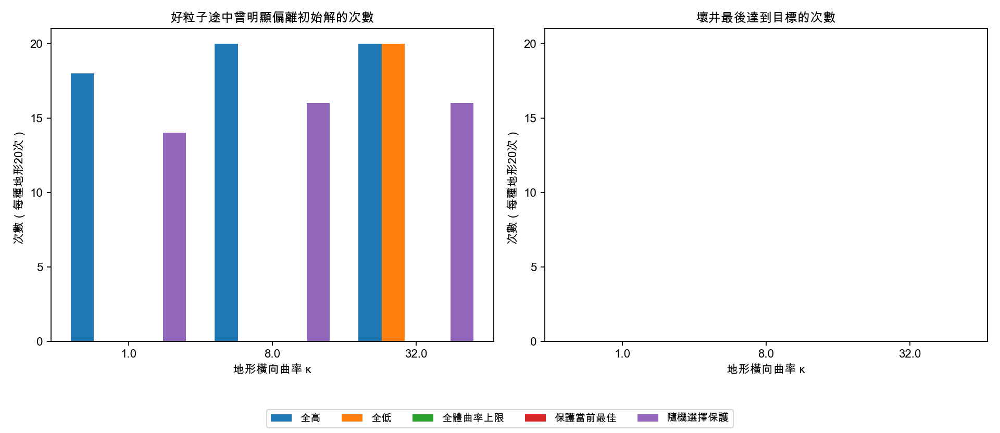
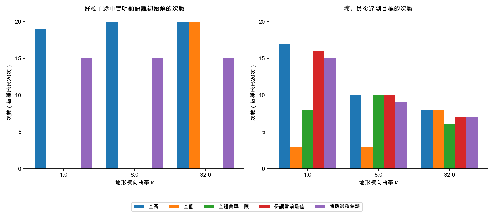

# E22：曲率配置初始化儲能的保護／探索取捨

> 名稱更新（2026-11-10）：統一使用「**好粒子途中曾明顯偏離初始解的次數**」。判定仍是已保存觀察點的最大loss上升超過0.0001；每種地形20次，20/20代表全發生、0/20代表全未超過門檻。此處以loss上升衡量偏離，並非參數距離。新圖縱軸用20次中的次數；原數據、門檻及實驗結論維持，舊圖完整保留。

協議於2026-11-09固定，2026-11-10執行。承接E21的曲率／高度微擾放大證據，這輪比較整體減能與同總能量的分工配置，檢查能否保護已有好點又維持壞井探索；不作證明或新通用優化器宣稱。

**目前最具體的發現是「保護目前最佳、其餘保留探索能量」值得繼續研究。** 原零初速批600條顯示保護效果，但全部探索對照為0，不能作聯合效益結論。結果驅動、另行固定的新初速批600條，在相同總初始能量下，好粒子途中曾明顯偏離初始解的次數由19／20／20降至0／0／0，壞井最後達標由17／10／8變為16／10／7（各剛度分母20），通過本輪事先固定的描述性篩選；尚未證明探索非劣或通用優勢。兩批分開解讀，另60條工程預檢不納入效益。

## 固定系統、資料與成本

新旋轉二維雙井f(r)=.25(r0²−1)²+.05r0+.5*k*r1²、r=Qx，橫向剛度k=1/8/32。Q與四個norm.001位移由種子固定，各政策與剛度共用。good_present有一顆近左井全局最低點、三顆近右井；bad_only四顆皆在右井。已知根／最小值只供初態及評分，初始化規則只用當前付費值及梯度探針。

四單位點粒子，g=.5、h=.05、原ramp、零初速、最多500步；無二體作用，只有自然彈性地形反彈。獨立點雲允許初始重疊，專用adapter保留地形可行性且禁止binary=True。此設定隔離初始化分配，不能當作真實相互碰撞球的保護結果。相較E21，四起點與.001微擾是新的探索測試，不冒稱其1e-8診斷的配對性能改良。

正式1400–1419，共20個種子群組、120共享contexts、600實際政策軌跡；預檢1390另30軌跡、不混入效益樣本。無調參／模型擬合。每方法實際總額度6000，所有初始化、曲率探針與後續查詢付費；無目標早停。4進程、數值執行緒1，保存精確來源／資料hash、真實命令／UTC時間／環境與原始狀態／事件。

## 五個初始化方法

H為離地高度。所有方法只在t0選H，其後不刪高度、不補能、不改反射規則。

| 政策 | 配置 | 初始總離地位能 |
|---|---|---:|
| fixed_high | 四顆H=.8 | 1.6 |
| fixed_low | 四顆H=.02 | .04 |
| cap_all | 每顆H=min(.8,.2/max(lambda,1e-6)) | 隨曲率，通常較低 |
| reserve_best | 當前最低值粒子採cap，其餘均分省下的高度 | 1.6 |
| reserve_random | 同樣分配，但保護索引只由種子決定 | 1.6 |

lambda由每個當前點四梯度中央差分(step1e-5)的對稱Hessian最大特徵值估計；原始探針／有號特徵值均保存。.2來自E21較保守的測試區間，沒有用E22效益選參數，也不是通用安全門檻。選當前最低值不等於知道哪個局部井是全局最好；bad_only會保護其中一個壞井點，仍由其他三顆探索。

兩種reserve與fixed_high共享相同初始總E與總P0；fixed_low／cap_all的初始能量較少，分開解讀。三種同能量方法仍可能有不同的耗散、接觸與運動時間，未聲稱軌跡熱量相同。

每context實際先執行四值、十六梯度共20次探針並共用。固定方法只計必要4值前綴，曲率方法計20；再實付初始化驗證4值及後續查詢。共同資訊重用的實際節省與每條政策自己的付費分開，固定法沒有被迫支付未使用曲率。已知井根的三參考值另列設定成本；沒有把判讀用答案輸入規則。

## 預定評分與解讀範圍

主指標於實際查詢終點。bad_only最後達標需左井且loss<=全局最低+.1*(初始群體最佳−全局最低)；另外報曾達標、曾到左井及第一次時間。good_present主要追蹤粒子0的最大／最後loss相對它實際初值的上升，曾上升>1e-4為傷害；亦保存相對真最小值及位置距離。初態是近好點而非精確靜止解。

群體當前最低與歷史最佳分開。good_present起初就有好點，保存archive會自然保住交付候選，不能把這件事當作活動粒子保護或新增探索收益。各context另衍生五方法最短終點的共同.05觀察網格，無插值或額外執行，避免把等查詢與等物理時間混為一談。

預定正面篩選：reserve_best相對fixed_high，至少2/3剛度的好粒子途中明顯偏離比例降低≥25百分點，且每剛度bad_only最後達標不可少超過2/20；同時無solver失敗、初始E/P與查詢帳正確。這只是本次篩選，不是統計定理。reserve_random用來檢查保護目前最佳的位置選擇是否比任選一顆有價值。所有失敗保留分母，20種子內多條件／多政策有相關性，不當600獨立樣本。

## 驗證與版本

新增9測試通過（9.62秒），完整262測試通過（12.86秒）。全部新檔名在建立前核對未使用，E21已封存模型／測試無改動。預檢30軌跡／6contexts無數值／接觸失敗，核對2370物理點、490地形事件、96曲率梯度探針；最大能量2.68e-15、外部動量1.42e-15、同能量配置差4.45e-16，主要原始指標重算差0。

預檢實際solver32780查詢、設定18，共32798；各政策重計自身必要前綴後33068，兩者差來自共享48查詢/context的重用。預檢只用於工程檢查，沒有按其效益修改政策／常數／種子。

## 原固定零初速批次：保護有效，探索對照無辨識力

600軌跡全完成、無solver數值／接觸失敗，每政策實際計價用滿6000。下表是good_present粒子0「曾比自身初值上升>1e-4」的數量，每格分母20：

| 政策 | 剛度1 | 剛度8 | 剛度32 |
|---|---:|---:|---:|
| 全高 | 18 | 20 | 20 |
| 固定低 | 0 | 0 | 20 |
| 全體曲率cap | 0 | 0 | 0 |
| reserve_best | 0 | 0 | 0 |
| reserve_random | 14 | 16 | 16 |

reserve_best與全高初始總E/P相同，最大能量差4.45e-16，因此這個活動粒子保護訊號不能只由整體減能解釋。固定低高度在最高剛度仍20/20曾明顯偏離初始解，雖最後都回到目標；僅報最後／歷史最佳會漏掉途中明顯偏離。reserve_best粒子0最大上升中位數約0／5.61e-7／3.28e-6，全高為.004163／.339442／.322015。

good_present群體最後達標數為全高20／7／2，reserve_best20／20／20，reserve_random7／4／4，固定低與全cap皆20／20／20；歷史達標所有政策皆20／20，因為初態已給好點，不能當新增探索收益。五政策共同最短時間約16.4／16.4／13.8時，明顯偏離數仍保持上表，保護差異不只來自查詢終點時間不同。

**探索部分不能作正面結論。** bad_only的五政策，在三剛度的曾到左井、曾達標、最後達標全部0/20。原預定`joint_screen.json`雖由「保護降低、最後成功0對0未下降」算出true，這是機械條件通過，並未證明探索被保留。原檔不覆寫，另以`joint_screen_interpretation.json`標記探索不具辨識力、尚未建立joint efficacy。

這批正式實際solver3,594,240、參考設定360，各政策前綴各計後3,600,000；實際重用節省5760。核對223493物理點、92074地形事件、1920曲率梯度探針，最大能量9.06e-15、動量2.14e-15、主要指標差0。132共享來源檔與預檢一致，只有分析檔新增，沒有讀預檢結果調參。



## 結果驅動的移動探索者補充

為使探索測試有機會辨識，先固定[補充協議](research/2026-11-10-energy-exploration-amendment.md)，另外使用新1440–1459做600條。particle0保持靜止，其餘三顆用各種子各向同性水平高斯速度扣均值、調至群體K=.6、總P0，豎直速度0；沒有提供朝向低井的方向。所有政策／條件／剛度在同種子共用速度。K=.6沿用專案舊群體慣例，不是搜尋多個幅度後選中者。

高度政策、曲率估計、指標、6000額度與原ramp保持不變，無運行中補能。原零動能批完整保留；補充是見到原基線全0後的新初態追查，不能冒稱原預註冊未觸碰確認，也不將不同種子的兩批差當動能的配對因果效應。高度cap尚未約束移動成員的總動能；保護靜止incumbent的結果不自動適用已有動量的好粒子。

新批另要求全高對照在**每個剛度至少5/20最後達標**，才容許對joint screen作整體解讀；未達標時，該最後品質比較仍不具足夠辨識力。原≥25百分點保護與每剛度不可少超2次最後達標條件維持。若此批仍不足，不在本輪追加第三套初速搜尋。

新增K/P與同能量測試後完整264測試通過（14.79秒）。補充1430預檢30條無失敗，solver33980、參考設定18；核對2358物理點、561地形事件與96梯度探針，最大能量3.24e-15、動量9.74e-16、初始同能量差8.89e-16、主要指標重算差0。新方法／核心物理未改，變動只擴充受控初始速度與新批次標記，所有版本封存。

### 移動探索者：保護穩定重現，探索取捨有初步可讀訊號

新600條全部用滿各自6000查詢，無數值／接觸失敗。下表每格均為20個配對種子；三個數字依序對應剛度1／8／32。兩種條件分開執行，「保護」與「從全壞初態探索」並非同一軌跡的兩個成就。

| 初始化政策 | 已有好點：粒子0途中曾明顯偏離初始解的次數 | 已有好點：群體最後達標 | 全壞初態：曾達標 | 全壞初態：最後達標 |
|---|---:|---:|---:|---:|
| 全高 | 19／20／20 | 20／9／3 | 17／10／11 | 17／10／8 |
| 固定低 | 0／0／20 | 20／20／20 | 8／10／10 | 3／3／8 |
| 全體曲率cap | 0／0／0 | 20／20／20 | 8／10／10 | 8／10／6 |
| reserve_best | 0／0／0 | 20／20／20 | 16／10／11 | 16／10／7 |
| reserve_random | 15／15／15 | 8／5／5 | 15／9／10 | 15／9／7 |

同總能量的reserve_best保護粒子0，而reserve_random仍有15/20明顯偏離，支持「保護誰」有實際影響。粒子0最大loss上升中位數，全高為.007615／.339916／.313744，reserve_best為0／1.16e-7／2.24e-6；它最後相對自身初值的中位變化為−7.65e-7／−2.63e-6／−8.98e-6。不能從0/20明顯偏離推出真實明顯偏離機率為0，且保護對象在本批仍是零水平初速的粒子。

探索對照現在有17／10／8最後成功，均超過新協議≥5/20的辨識門檻；reserve_best各少1／0／1次，滿足原先「每剛度最多少2次」篩選，故`joint_evidence_interpretable=true`。這是描述性小樣本篩選，沒有預定功效計算或統計非劣性檢定。配對成功表（兩者皆成功／僅reserve成功／僅全高成功／兩者皆失敗）為16/0/1/3、10/0/0/10、5/2/3/10；最高剛度的差不只是同一條路徑的單一失敗，而有雙向換人。全cap在剛度1的探索只有8/20，支持分工可避免該設定的整體減能損失；在剛度8兩者同10/20、剛度32只差1次，不能宣稱全設定皆改善。

最高剛度reserve_best曾達標11/20、最後只7/20，仍有4個歷史成功最後丟失；保存歷史最佳不能抹掉這項缺口。已有好點條件的歷史成功則所有政策皆20/20，因為初態已含目標，不作新增成果。

共同最短物理時間的保護明顯偏離數仍是全高19／20／20、reserve_best0／0／0；但bad_only當時達標為全高15／5／2、reserve_best11／7／1，剛度1差4次。因不同分配改變接觸頻率與耗散進度，**等查詢終點的探索取捨不能外推為等時間不受損**。原始共同時間表保留全部五政策，不改用較有利窗口當主結果。



### 物理、成本與研究決定

補充正式核對225643物理點、88165地形事件、1920曲率梯度探針，能量帳最大殘差9.25e-15、動量帳8.35e-16、同初始總能量差8.89e-16、主要指標差0。獨立分析核對兩正式批各600份逐粒子能量帳、30摘要組與120共同時間context。40個既有核心模型檔與高度分配／曲率估計／評分函數保持一致，原零初速結果未覆寫。

| 批次 | 實際軌跡 | 共享初態context | 實際solver查詢 | 設定參考值 | 各政策自身計價總和 |
|---|---:|---:|---:|---:|---:|
| 原預檢 | 30 | 6 | 32,780 | 18 | 33,068 |
| 原正式（零初速） | 600 | 120 | 3,594,240 | 360 | 3,600,000 |
| 移動探索者預檢 | 30 | 6 | 33,980 | 18 | 34,268 |
| 移動探索者正式 | 600 | 120 | 3,594,240 | 360 | 3,600,000 |
| 合計 | 1260 | 252 | 7,255,240 | 756 | 7,267,336 |

含設定的實際執行共7,255,996查詢；共享重用節省12,096，不算某方法免費取得額外資訊。事後原始稽核另有1,997,754值／185,322梯度呼叫，與solver額度分開；彙總核對與能量參考視圖沒有新增oracle呼叫。保存完整初態／探針、每條軌跡、反彈事件、未完成步付費、來源archive與檔案manifest。252contexts與1260軌跡不能當1260獨立種子；兩正式批各20種子，跨批不同種子，預檢各1種子。

地形固定，理想彈性接觸瞬間由牆承受反作用衝量，粒子動能守恆；整段粒子動量受重力、地形衝量與阻尼改變，並非封閉守恆系統。重力位能與動能的交換、外部阻尼移除的熱、外部衝量及數值殘差分開列帳。能量分配發生在t0，不是運行中由別顆球傳來的碰撞能量；本輪沒有二體碰撞或在線介入。

決定保留「曲率配合的好點保護＋探索者分工」作下一候選，暫不擴充方向預測器、不追加第三套初速搜尋，也不急著寫一般證明。下一個有價值的獨立驗證是固定現有規則，在不同障壁／曲率地形與帶動量的好點檢查保護是否仍成立；之後才測二體接觸會否破壞分工，以及曲率資訊是否優於同預算固定低高度保護。這些尚未執行。本輪是二維合成機制／取捨證據，沒有SGD、AdamW或NanoGPT新排名。

## 重現與來源

[協議](superpowers/specs/2026-11-09-curvature-energy-design.md)、[計畫](superpowers/plans/2026-11-09-curvature-energy-plan.md)、[總紀錄](experiment_log.md)。每個新資料夾均拒絕覆寫；原始完整模型、付費未完成步／不可恢復中間狀態與所有停止原因保存。

```sh
PYTHONPATH=src OMP_NUM_THREADS=1 OPENBLAS_NUM_THREADS=1 MKL_NUM_THREADS=1 python3 run_curvature_energy.py --output output/collision_curvature_energy_new --stage formal --workers 4
PYTHONPATH=src python3 audit_curvature_energy.py output/collision_curvature_energy_new
PYTHONPATH=src python3 analyze_curvature_energy.py output/collision_curvature_energy_new
python3 check_curvature_energy.py output/collision_curvature_energy_new
# 移動探索者使用不同新目錄與 --stage kinetic；其工程預檢為 --stage kinetic_preflight。
```
