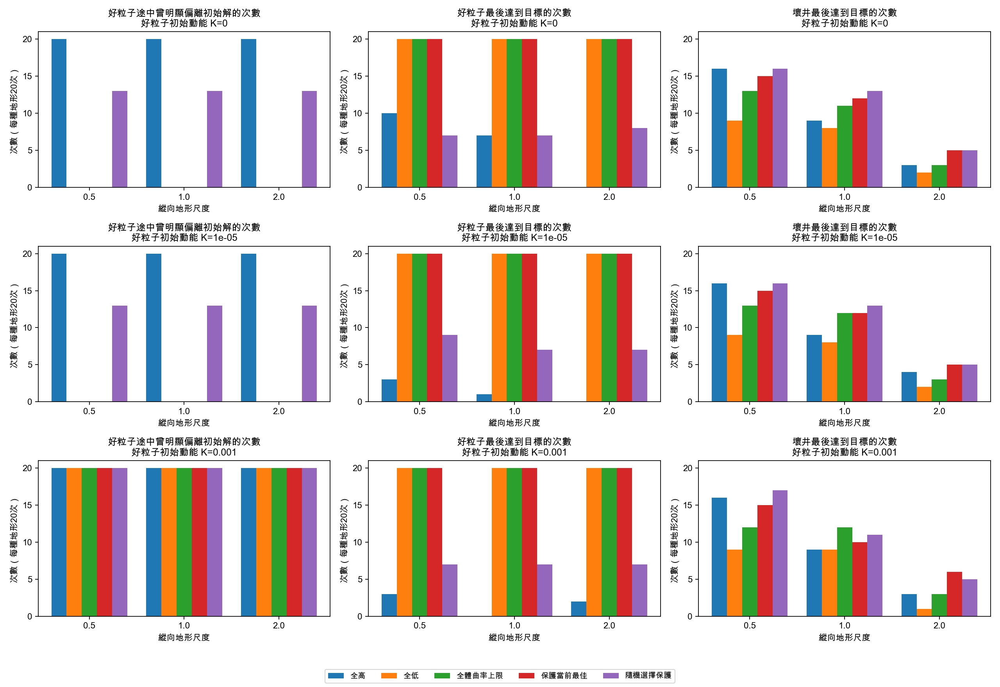

# E23：帶動量好點與障壁尺度的固定規則復驗

> 名稱更新（2026-11-10）：統一使用「**好粒子途中曾明顯偏離初始解的次數**」。判定仍是已保存觀察點的最大loss上升超過0.0001；每種地形20次，20/20代表全發生、0/20代表全未超過門檻。此處以loss上升衡量偏離，並非參數距離。新圖縱軸用20次中的次數；原數據、門檻及實驗結論維持，舊圖完整保留。

2026-11-10先固定協議，承接E22的初始化分工證據，驗證好點本身有動量及改變障壁時是否仍能保護。五種高度政策與所有參數不變；沒有預先改成總能量控制，也沒有球與球碰撞。

**本輪取得的是適用範圍：小動量仍可避免超過原明顯偏離門檻；較大動量可大幅減少偏離放大並在最後恢復，但不能維持途中不偏離。** 分工配置在九個尺度／動量條件的好粒子最後皆20/20達標；較大動量仍各20/20曾明顯偏離初始解，因此原保護篩選失敗。三個動量組的最高障壁對照皆不足5/20成功，整體聯合效益的辨識門檻全部未通過。這些負面／不具辨識力的結果保留，不改門檻或追加有利參數。

## 固定設計與解讀

旋轉二維地形f(r)=a*(.25*(r0²−1)²+.05*r0)+4*r1²，a=.5／1／2。此尺度同時改變障壁高度及縱向曲率；橫向剛度固定8，所以不解讀為單獨障壁的因果效應。每種子四個norm.001位置微擾／旋轉共用，good_present一顆近全局好井、三顆近壞井；bad_only全在壞井。已知根／極值只用於初態與評分。

三個a仍屬同一雙井函數族、極值位置與井拓撲相同；旋轉本身只是座標等距變換。這不是跨任意地形族或高維的驗證。

particle0初始水平動能e=0／1e-5／1e-3。總K固定.6、P固定0，垂直速度0。令原三探索者零和速度為w、其動能.6，種子各向同性方向d、u=sqrt(2e)*d，則v0=u、其餘vi=sqrt(1−4e/(3*.6))*wi−u/3。各政策／尺度／兩條件共用速度，同種子的三動量由同w/d配對。方向未使用地形答案。e=0重現E22移動探索者構造；新種子不是原20種子的重複比較。

e的兩個非零尺度夾住g×1e-4=5e-5：在地形表面，該值是loss精度門檻對應的重力位能差。e=1e-3雖只有群體總K的約.17%，仍是這個局部尺度的20倍。這是選尺度的物理理由，不是聲稱動能必定全部轉成loss上升；實際交換取決於出入射、接觸、耗散與軌道。

五政策仍是全高H=.8、全低H=.02、全cap H=min(.8,.2/max(lambda,1e-6))、保護當前最低值並把省下高度分給其他三顆、種子任選保護索引的同配置。lambda用當前點四次付費梯度中央差分估計。兩種reserve與全高初始總E/P相同；低高度／全cap能量較少。所有配置只在t0做，之後沒有加能、重置、主動反射或在線調參。

本輪各初點的最大曲率由橫向剛度8主導，故cap約.025，在這些初態等價於固定相同高度。本輪只測既有規則的動量／障壁適用範圍，不能證明付費曲率比直接固定.025更有價值；固定低.02也不是相同高度與分工的成本對照。此限制在正式批次未完成、未看效益前已記錄，不追加新對照來挑選結果。

等初始總E的對照僅指同一context內的全高與兩reserve；不同a會改變地形位能，不能說跨地形總E相同。三動量則在相同位置與高度政策下保有相同總E，改的是能量／動量在成員間的分配。

四單位獨立點粒子、g=.5、h=.05、原ramp，最多500步、各政策從初始化起總額度6000，無目標早停。共享20探針實際執行一次，固定法只付必要4值前綴、曲率法20；各方法的實際初始化重驗與之後查詢照付，三參考值/context另列。保存未完成步的成本與最後已提交狀態。

正式1500–1519，三尺度×三動量×兩條件×五政策×20種子=1800軌跡／360共享context，僅20個獨立種子群組。1490工程預檢另90條／18contexts、1200額度／80步，不納入效益、不按結果調參。4進程，數值執行緒1。全部新檔名檢查未使用，E22與舊核心檔不改寫，實際來源／環境／命令與資料封存。

主要仍報好粒子最大／最後loss上升及曾上升>1e-4、群體當前最低／歷史最佳、壞井曾與最後達標、越井分開。新增particle0最後是否回到global minimum+1e-4且位於左井。已有動量可能正常上坡，因此曾明顯偏離初始解不是數值不穩證明，也不事後提高門檻。各e分開作原描述性保護／探索篩選：至少2/3尺度途中明顯偏離比例降低≥25百分點、各尺度最後壞井成功不減超2/20、無solver失敗，另要求全高每尺度至少5/20最後成功才可聯合解讀；不作統計非劣宣稱。

共同最短物理時間的比較保留全部五政策、不插值、不是新執行。20種子跨政策／尺度／動量相關，不當1800獨立樣本。原始定義、連續差值與最後恢復並列，不按結果換主指標。

## 工程與來源驗證

新增8項測試通過（1.78秒），完整272項通過（21.46秒）。驗證a=1與原地形逐值相同、縮放後梯度／解析路徑、共用雲與障壁尺度、總K/P與particle0 K、e=0速度完全相同、實付曲率與等能量、短暫偏離和最後恢復分開、五政策成本。E22模型／runner／測試與其封存版本相同。

首次事後核對因尺度a與探針a同名、閉包讀到陣列而中斷。失敗工具來源與audit_failure.json保留，未持久化的部分核對成本未知；只修核對工具名稱，沒有重跑或改動軌跡。修正後90條原始核對通過，7188物理點、1704地形事件、288梯度探針，能量帳殘差3.57e-15、外部動量6.81e-16、同初始總E差8.89e-16，主要指標重算差0，無solver失敗。預檢solver103104、參考設定54，共103158；政策自身計價103968。沒有查看預檢效益來調參。

逐軌跡能量收支匯出的開發檢查另發現初始列阻尼欄空白，已修正為只加總更新列1:。失敗工具來源及ledger_export_failure.json保留，新增oracle呼叫0；沒有再執行軌跡。收支表只描述已提交的物理路徑，未完成步的查詢成本照計，但求解器未回傳的中間物理狀態不虛構入帳。

## 正式結果：途中偏離與最後恢復

每格分母20，依序對應障壁尺度a=.5／1／2；「最後達標」追蹤原本的好粒子0，不以其他粒子或archive代替。

| 粒子0初始K | 全高：曾明顯偏離初始解 | reserve_best：曾明顯偏離初始解 | 全高：粒子0最後達標 | reserve_best：粒子0最後達標 |
|---|---:|---:|---:|---:|
| 0 | 20／20／20 | 0／0／0 | 10／7／0 | 20／20／20 |
| 1e-5 | 20／20／20 | 0／0／0 | 3／1／0 | 20／20／20 |
| 1e-3 | 20／20／20 | 20／20／20 | 3／0／2 | 20／20／20 |

較大動量e=.001時，good_present的粒子0最大loss上升中位數如下；不是把中位數比值當成每個種子的改善比例。

| a | 全高 | reserve_best | 兩中位數的比值（全高／分工） |
|---|---:|---:|---:|
| .5 | .292340 | .001492 | 約196 |
| 1 | .289099 | .001417 | 約204 |
| 2 | .257871 | .001547 | 約167 |

九個條件各20個配對，reserve_best相對全高的最大上升皆較小（差值容差1e-6），但這些180個比較只有20獨立種子群組。e=1e-5的reserve_best最大上升中位數約1.43e-5／1.45e-5／1.44e-5；e=.001約1.5e-3，已超過原1e-4門檻，不能把它叫作全程未超過偏離門檻。最後上升中位數則只有9.16e-6／7.77e-6／1.96e-6，與20/20原好粒子最後達標相容。

固定低與全cap在三種e／三尺度也都是粒子0最後20/20達標，曾明顯偏離初始解在前兩種e皆0/20、較大e皆20/20。故保護／恢復不是reserve_best獨有；分工的研究問題是能否同時保留其他粒子的探索。reserve_random在前兩種e各尺度13/20曾明顯偏離初始解、最後7–9/20原好粒子達標；較大e全20/20曾明顯偏離初始解、最後各7/20。選擇目前最佳有作用，卻尚未建立付費曲率估計的必要性。

共同最短物理時間，reserve_best的原好粒子最後仍在所有九格20/20達標；與全cap的最大上升20/20配對在每格都落於1e-6差值容差內，中位差0。二體作用關閉、相同好粒子高度／動量下，這與其本身受到相同局部運動規則相容，不能把其保護效果歸因於探索者撞回了好粒子。

## 壞井探索、歷史丟失與辨識門檻

下表是bad_only最後群體達標，各格20次，三數仍依序a=.5／1／2。對照與reserve的同初始總E比較限於每個相同context。

| 粒子0初始K | 全高 | 固定低 | 全cap | reserve_best | reserve_random | reserve_best曾達標 |
|---|---:|---:|---:|---:|---:|---:|
| 0 | 16／9／3 | 9／8／2 | 13／11／3 | 15／12／5 | 16／13／5 | 17／13／6 |
| 1e-5 | 16／9／4 | 9／8／2 | 13／12／3 | 15／12／5 | 16／13／5 | 17／13／6 |
| 1e-3 | 16／9／3 | 9／9／1 | 12／12／3 | 15／10／6 | 17／11／5 | 17／11／7 |

全高與reserve_best最後成功差依e為−1／+3／+2、−1／+3／+1、−1／+1／+3，全部符合「不可少超2/20」描述性條件。可是最高障壁的全高只有3／4／3次，全部低於事先固定的5/20辨識門檻。e=0與1e-5雖機械篩選通過，joint_evidence_interpretable仍false；e=.001另因20對20曾明顯偏離初始解、沒有降低途中明顯偏離比例而機械篩選也false。沒有任何e可通過本輪整體聯合解讀，亦未作統計非劣證明。

reserve_best仍有歷史成功最後丟失，例如e=.001、a=.5為17曾達標而15最後保留。good_present的歷史群體達標則各政策皆20/20，因初態已含好點，不作新探索成功。完整成功切換與連續配對保存在paired_contrasts.json，不只報總數。

等時間的探索不保持同樣差異：共同最短時間bad_only的全高／reserve_best最後達標，e=0為10/8、4/4、3/3；e=1e-5為11/8、5/4、3/5；e=.001為13/7、6/3、3/5（依a）。例如較大e、最低障壁，分工在等查詢最後僅少1次，但等時間少6次。保留探索能量不等於保證更快探索；時間／查詢／耗散的取捨仍需明確。



## 核對與研究決定

正式1800條無solver數值／接觸失敗。原始核對680928物理點、260066地形反彈、5760曲率梯度探針，最大能量帳殘差1.31e-14、外部動量8.13e-16、同初始總E差8.89e-16、主要指標重算差0。143共享啟動來源除已保留的稽核變數名修正外一致，正式另新增登錄工具；42個E22已有src檔完全相同。後處理收支匯出與報告版本另封存。

成功的兩次完整原始稽核另用3,016,880值／267,818梯度呼叫；首次失敗的部分呼叫未知，不混入solver或宣稱為完整事後成本。彙總／共同時間／逐軌跡收支匯出新增oracle0。收支區分粒子K+g*z、重力做功、阻尼移除的熱、衝量能量與數值殘差；原始稽核另核對牆／重力／阻尼的動量收支。固定牆承擔反作用衝量，彈性接觸瞬間動能守恆；整段粒子系統受外場及耗散，不宣稱其自身動量或機械能不變。

這輪支持的具體方向是以「位置、局部儲能與動量」共同描述保護：高度限制可抑制擾動放大，較大初始動量仍會帶來正常或放大的暫態偏離。尚未隔離其每一部分的因果來源，也未建立一般安全界線。下一候選實驗應在相同總E/P下消融好粒子的初始動量分配，並加入固定同高度的付費對照，先回答動量重分配及曲率資訊各有多少必要性；這些尚未執行。二體碰撞會否破壞保護也仍未測，不能將本輪當相互撞擊球、一般地形、高維或NanoGPT／AdamW優勢。E23到此停止，不追加有利初速／高度，不先寫通用證明。

## 執行成本

| 批次 | 實際軌跡 | 共享context | solver實際查詢 | 設定參考值 | 各政策自身計價 |
|---|---:|---:|---:|---:|---:|
| 工程預檢 | 90 | 18 | 103,104 | 54 | 103,968 |
| 固定正式 | 1800 | 360 | 10,782,720 | 1080 | 10,800,000 |
| 合計 | 1890 | 378 | 10,885,824 | 1134 | 10,903,968 |

含設定的實際執行10,886,958查詢；各政策自身計價與實付solver差18,144，來自每context共用48次資訊重用，未當免費資訊。正式所有政策都實際用滿自身6000。根目錄JSON／CSV、共同時間、彙總、配對與圖不是額外實驗；正式20個獨立種子群組，不是1800個獨立樣本。首次失敗稽核未保存的部分成本未知，與成功稽核／零oracle收支匯出成本分開，不冒稱完整事後成本已知。

## 重現與紀錄

[固定設計](superpowers/specs/2026-11-10-energy-generalization-design.md)、[執行計畫](superpowers/plans/2026-11-10-energy-generalization-plan.md)、[總紀錄](experiment_log.md)。每個輸出目錄拒絕覆寫，原始啟動來源與最終分析來源分別保存。

```sh
PYTHONPATH=src OMP_NUM_THREADS=1 OPENBLAS_NUM_THREADS=1 MKL_NUM_THREADS=1 python3 run_energy_generalization.py --output output/collision_energy_generalization_new --stage formal --workers 4
PYTHONPATH=src python3 audit_energy_generalization.py output/collision_energy_generalization_new
PYTHONPATH=src python3 analyze_energy_generalization.py output/collision_energy_generalization_new
```
