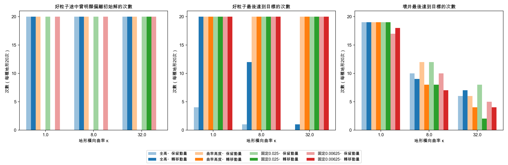

# E24：相同初始E/P下的高度與動量配置消融

> 名稱更新（2026-11-10）：統一使用「**好粒子途中曾明顯偏離初始解的次數**」。判定仍是已保存觀察點的最大loss上升超過0.0001；每種地形20次，20/20代表全發生、0/20代表全未超過門檻。此處以loss上升衡量偏離，並非參數距離。新圖縱軸用20次中的次數；原數據、門檻及實驗結論維持，舊圖完整保留。

2026-11-10先固定協議，承接E23的「小動量保護、較大動量有偏離但可恢復」。本輪分開測動量配置和高度策略，加入固定同高度與固定保守高度兩個付費對照；不是在線控制器或已實現的球間碰撞。

**具體機制已更清楚：低高度配合低動量能避免本測試的途中明顯偏離；一律移走當前最佳粒子的動量會犧牲部分探索。** curve_keep→curve_transfer的好粒子途中曾明顯偏離初始解的次數20／20／20→0／0／0，但壞井最後成功19／12／6→19／8／4。剛度8少4次，未通過預定聯合篩選；這次基線有辨識力，不能把失敗歸因於全零對照。固定保守高度＋同樣轉移也0／0／0明顯偏離，目前未建立付費曲率的必要性。

## 八組初態與守恆範圍

原旋轉二維雙井f(r)=.25(r0²−1)²+.05*r0+.5*k*r1²，k=1／8／32。四單位獨立點粒子、同種子norm.001位置微擾／旋轉，good_present一顆近好井三顆近壞井、bad_only全在壞井。已知極值只作初態／評分，不用於選保護對象。各方法都用四次付費值選j=argmin f(x_i)，全壞初態的j不一定為粒子0。

保留E23初始速度模板：粒子0 K=.001、群體K=.6、線性P0，豎直速度0；模板在政策／條件／剛度間共用。欄位incumbent_energy=.001指模板粒子0的轉移前動能，轉移後應讀selected_kinetic_after和實際初始狀態。八組＝以下四高度×keep／transfer：

| 高度模式 | 選中粒子高度 | 其餘三顆高度 | 曲率查詢費 |
|---|---|---|---:|
| high | .8 | .8 | 0 |
| curve | min(.8,.2/max(lambda_j,1e-6)) | .8+(.8−Hj)/3 | 16 |
| fixed_ref | .025 | .8+(.8−Hj)/3 | 0 |
| fixed_safe | .00625 | .8+(.8−Hj)/3 | 0 |

兩固定高度事先取自E23曲率8及E22曲率32的配置，不在新結果上選最好者。所有八組sumH3.2、離地位能1.6，且總初始E／K／線性P相同。不同剛度context的地形位能可以不同，不作跨地形等總E宣稱。曲率沿用每點四次梯度中央差分，舊政策／模型檔不改寫。

剛度值本身沿用既有研究，這是新種子的配置消融，不是未知剛度或新地形族確認。

keep保留模板速度。transfer令選中v_j'=0；其他w_i=v_i+v_j/3，再令v_i'=w_i*sqrt(sum_l||v_l||²/sum_{i!=j}||w_i||²)。零總P輸入使其他w零和，縮放保存總K；有限精度殘差獨立核對。非零K但剩餘相對速度退化時拒絕並記錄，不偷偷加方向或重抽種子。轉移只用既有值／速度，沒有額外oracle費。

這是八個配對初始狀態，沒有在運行中執行該映射。它一般不守恆角動量；保存同一配置位置下轉移前後L與ΔL，不能稱作完整內部彈性碰撞。運行中仍只有原固定牆反彈、重力及阻尼，沒有新供能或重置。high_transfer是「只移走選中速度、仍保留高儲能」對照。每顆能量、角動量、後續耗散／接觸頻率與運動時間不要求相同。

## 預定資料、成本與指標

正式1600–1619，兩條件×三剛度×八政策×20種子＝960實際軌跡／120共享context，只有20獨立種子群組。工程1590另48條／6contexts、1200額度／80步，不納入效益；正式每方法從初始化起6000查詢／最多500步，g=.5、h=.05、原ramp，不依目標早停，4進程、數值執行緒1。不擬合或調參，固定這批後不追加有利高度或速度。

共享4值＋16梯度共20查詢實際執行一次。只有兩curve方法各付20前綴，六固定法各付4；初始化重驗與之後呼叫另實付。故各政策自身計價相對實際共享執行，每context節省44，而非舊五政策的48。三個評分參考值/context另列；所有未完成步的已付成本保留。

好點仍報原粒子0途中最大／最後loss上升、曾上升>1e-4、最後位於左井且f<=global min+1e-4。壞井則報曾／最後達標與越井，群體歷史最佳與當前最低分開。主比較同高度的transfer對keep；主描述性篩選curve_transfer對curve_keep：至少2/3剛度途中明顯偏離比例降≥25百分點、每剛度壞井最後成功不減超2/20、無solver失敗，且curve_keep每剛度≥5/20才可聯合解讀。不是統計非劣證明。

curve_transfer須和兩個固定transfer對照並列，不因.025在高曲率失敗就推論付費曲率必要。共同最短.05物理時間另列，不插值或新增執行。k8記錄curve與fixed_ref初態有多接近、16次費差；有限差分捨入和軌道敏感性不保證完整浮點軌跡相同。

## 工程驗證

新增8測試通過（.62秒），完整280測試通過（32.30秒）。驗證任意選中索引的K/P、零速度／退化拒絕、非零索引的當前最低選擇、八組E/K/P、舊keep政策一致、固定控制不讀曲率、k8同高度、非零角動量變化揭露及44次共享計價。

48條預檢原始核對通過，3838物理點、838地形事件、96梯度探針，最大能量帳殘差3.19e-15、外部動量8.06e-16、八組同初始E差4.45e-16；初始角動量變化與評分重算差0，solver失敗0。預檢實際solver54254、參考18，共54272；政策自身計價54518。正式前未查看預檢效果調參，完整來源／原始資料保留。

## 完整八組正式結果

以下每格分母20，三個數字依序剛度1／8／32。好點追蹤原粒子0，歷史最佳不能代替活動粒子；壞井是另一套全壞初態，不把兩條件合成單條路徑的成就。

| 初始化 | 好粒子途中曾明顯偏離初始解的次數 | 好粒子最後達標 | 壞井最後達標 | 壞井曾達標 |
|---|---:|---:|---:|---:|
| high_keep | 20／20／20 | 4／1／0 | 19／10／6 | 19／10／10 |
| high_transfer | 20／20／20 | 20／12／1 | 19／9／7 | 19／9／9 |
| curve_keep | 20／20／20 | 20／20／20 | 19／12／6 | 19／12／11 |
| curve_transfer | 0／0／0 | 20／20／20 | 19／8／4 | 19／9／11 |
| fixed_ref_keep | 20／20／20 | 20／20／20 | 19／12／8 | 19／12／11 |
| fixed_ref_transfer | 0／0／20 | 20／20／20 | 19／8／2 | 19／9／10 |
| fixed_safe_keep | 20／20／20 | 20／20／20 | 17／10／5 | 19／12／11 |
| fixed_safe_transfer | 0／0／0 | 20／20／20 | 18／7／4 | 19／9／11 |

三個因素不能混為同一優勢：

- 只移走好粒子的初始動量、維持高高度，三剛度仍各20/20曾明顯偏離初始解。high_transfer的最大上升中位數.006247／.333858／.318134，後兩剛度甚至高於high_keep的中位數；移走動量本身不保證高儲能軌道不超過偏離門檻。
- 曲率高度下，保留動量仍20/20曾明顯偏離初始解，最大上升中位數.001393／.001404／.001574；配合轉移降至0／4.23e-7／2.96e-6，三剛度均0/20跨越1e-4門檻。這是本初態與成本窗口的觀察，不是一般穩定保證。
- 固定.025加轉移在最高剛度仍20/20曾明顯偏離初始解（峰值中位數.004965）；固定.00625加轉移則三剛度全0/20，且最後都20/20。不能只以較不保守的固定值失敗來宣稱曲率必需。

curve_keep本身最後已20/20恢復，故transfer的新增收益主要是途中保護，不是本輪好粒子最後達標率的提升。若實際任務只關心最後交付的好解，這個收益是否值得探索損失需另評估。good_present所有方法歷史群體達標20/20，因初態已給好點，不作新探索收益。

## 探索損失、廉價對照與時間口徑

主比較curve_transfer對curve_keep，三剛度保護率都改善100百分點，但壞井最後成功變化0／−4／−2，剛度8違反「最多少2/20」；baseline成功19／12／6皆≥5/20，這回探索對照具有辨識力。mechanical_screen_passed=false、joint_evidence_interpretable=false，不放寬準則或另挑有利對照。失敗的是預定的整體保護／探索取捨，不是物理核對。

成功切換（兩者皆成功／僅transfer／僅keep／皆失敗）為19/0/0/1、8/0/4/8、2/2/4/12。剛度8的4次下降沒有對應新增成功；剛度32有雙向換人，不能把總差−2當成原路徑被完整保留。最高剛度兩者曾達標皆11/20、最後6與4，既有越障能力與最後保留仍須分開看。

curve_transfer相對fixed_safe_transfer的最後壞井成功，只多1／1／0次，兩者好點保護同為0／0／0；20種子內尚無足夠證據建立額外曲率費的實用價值。fixed_safe由過去已測剛度範圍選定，不據此推廣到未知曲率。剛度8的curve與fixed_ref共80個初態配對，初始位置最大差1.82e-13、速度差0、curve多付16前綴查詢；共同時間粒子0位置最大差3.97e-12，兩組最後成功數相同。這是近同初態的成本對照，不保證所有浮點狀態完全相同。

共同最短時間，curve_keep／curve_transfer好粒子途中曾明顯偏離初始解的次數仍20／0、最後達標皆20（各剛度）；fixed_ref_transfer在32仍20明顯偏離，fixed_safe_transfer仍0。壞井在共同時間的curve_keep／curve_transfer為17/18、9/7、5/4，fixed_safe_transfer18／7／4、fixed_ref_transfer18／7／5。等時間沒有一致探索改善，不用較有利窗口替代等查詢主結果。

### 事後選擇診斷（探索性，不作確認）

看過主結果後，才按「被選中的是模板低動能粒子0，還是其他探索者」分組。剛度8的20種子有5次選中粒子0（K=.001）、15次選中其他粒子（所選K中位數.18737）；僅keep成功的4次，分別1次與3次。剛度32其他粒子組有4次僅keep、1次僅transfer；低動能粒子0組0次僅keep、1次僅transfer。該分組依既有模板，不是新判準，也未擬合或挑選閾值。完整探索性分組另存，零新執行／零oracle，不能當成已證明「只要選中高動能球就不該轉移」。



## 原始核對與研究決定

正式核對960軌跡／120contexts通過，371275物理點、129543次地形反彈、1920曲率梯度探針，能量帳最大殘差1.07e-14、外部動量8.99e-16、八組同初始總E差8.89e-16；所有主要評分、初態配置及角動量變化重算差0，solver失敗0。151共同啟動來源與預檢完全相同，僅新增登錄工具，44個E23已有src檔不變。

成功原始核對另1,631,715值／132,397梯度呼叫，與solver成本分開。彙總、共同時間、初始配置／角動量表及已提交軌跡能量收支匯出新增oracle0。預檢48列匯出驗證通過，殘差3.34e-15。未完成步付費照計，求解器未回傳的部分物理狀態不虛構。保存逐軌跡初始選中粒子的K、gH、總K/P、同位置L變化、後續重力做功、阻尼熱及數值殘差。

研究方向收斂為「何時值得保護當前最佳點、何時保留它的探索動量」。僅按當前排名一律轉移，會把仍在壞井的探索者停下來；此構造同時改變其餘速度分配，因此不能單獨歸因於某一顆球。下一候選應先分析已有付費資訊能否辨認值得保留的好點，再於新資料檢驗條件式配置；尚未實作或在本輪資料調參。這輪不支持直接部署一律轉移法，也不支持宣稱付費曲率必要；可將高度／動量共同影響整理成有限範圍的機制命題，再決定證明範圍。

全部仍是同一二維雙井族、初始化消融、無二體作用，沒有在線干預、角動量守恆的碰撞實現、高維／NanoGPT／AdamW新排名。E24到此停止，不追加有利政策或參數。

## 執行成本

| 批次 | 實際軌跡 | 共享context | solver實付查詢 | 設定參考值 | 各政策自身計價 |
|---|---:|---:|---:|---:|---:|
| 工程預檢 | 48 | 6 | 54,254 | 18 | 54,518 |
| 正式 | 960 | 120 | 5,754,720 | 360 | 5,760,000 |
| 合計 | 1008 | 126 | 5,808,974 | 378 | 5,814,518 |

含設定的實際執行5,809,352查詢，實際共享重用節省5544=44×126。正式所有方法都用滿自身6000，所有預算中止／最後已提交狀態保留。各方法wall_seconds另存，但受同機負載、四進程與固定政策順序影響，只作描述，不能把等查詢當等CPU或受控速度比較。JSON／CSV、共享context、共同時間／配對／收支視圖不重算新實驗。

## 重現與紀錄

[事先固定設計](superpowers/specs/2026-11-10-initial-budget-design.md)、[執行計畫](superpowers/plans/2026-11-10-initial-budget-plan.md)、[總紀錄](experiment_log.md)。全部新檔名先檢查未使用，各輸出目錄拒絕覆寫；啟動與最終後處理來源分別保存。

```sh
PYTHONPATH=src OMP_NUM_THREADS=1 OPENBLAS_NUM_THREADS=1 MKL_NUM_THREADS=1 python3 run_initial_budget.py --output output/collision_initial_budget_new --stage formal --workers 4
PYTHONPATH=src python3 audit_initial_budget.py output/collision_initial_budget_new
PYTHONPATH=src python3 analyze_initial_budget.py output/collision_initial_budget_new
```
