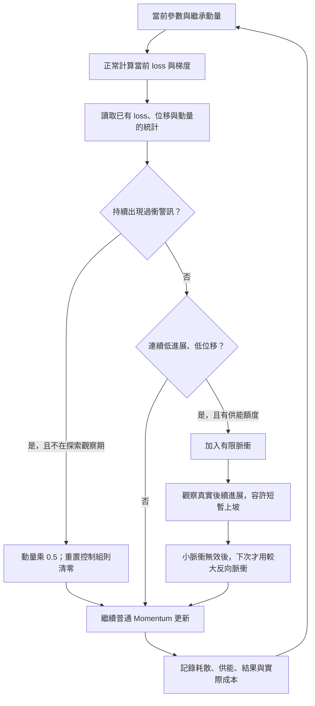

# 用動量狀態選擇繼續、減速或加能：本輪結果

已完成 **360 次合成實驗、18 次 NanoGPT 訓練、189 個測試**。規則在正式執行前固定，沿用上一輪選定的基底設定，沒有按新結果調參。

**這版解決了額外模型診斷的查詢成本，但尚未解決「停滯與收斂難以區分」。加能可以逃離鞍點，也會破壞好解；NanoGPT 的小幅平均改善完全來自減速，加能沒有觸發。**

## 實際流程



這是以力學作為設計依據的 **Momentum 控制器**，沒有真實小球或剛體表面。減速與脈衝是人為控制動作，不能稱為自然發生的碰撞反射。

### 如何判斷「可能需要減速」

使用上一步繼承速度 v 和當前有效梯度 g。三條件同時成立才算一次警訊：

1. `cos(v,g) > 0.1`，繼承方向有上坡分量。
2. `||v|| > 2*lr*||g||`，繼承速度比當前純梯度步大。
3. `||v||/(1+||theta||) > 0.001`，排除極小移動。

最近三次有兩次警訊才減速，間隔至少 10 個更新，一次執行最多 20 次。這只判斷持續的方向衝突，**不證明該方向必然不好**。它沒有曲率或未來地形資訊，可能誤傷有益動量。

### 如何判斷「可以嘗試加能」

合成函數每 10 次更新為一個視窗，連續兩個低進展、低移動視窗才允許脈衝。進展採歷史最佳 loss 的相對改善，門檻 0.0001；平均相對位移門檻 0.001。

NanoGPT 每個視窗 20 次更新，直接使用訓練本來就會計算的 minibatch loss。比較相鄰視窗平均值，門檻為 `0.001 + 2*SE/(1+abs(previous_mean))`。不同 batch 的噪聲較大，SE 僅作啟發式容忍量；沒有獨立性或顯著性保證。控制器完全不讀 tuning/test loss。

自適應版先用小脈衝；經兩個真實視窗仍未見足夠進展，下次才加大並反轉上一個方向。沒有虛擬預演，觀察到的進展也不是介入的因果效果。脈衝間隔至少四個視窗，最多兩次。

**脈衝後兩個視窗暫停主動減速**，讓它有機會短暫上坡、穿越山嶺。普通梯度力及自然動量衰減仍持續。

## 能量、動量與做功

採單位質量，速度為每次更新的參數位移，K=||v||²/2。沿單位方向 d 注入 J=alpha*d：

`alpha = -v·d + sqrt((v·d)^2 + 2E)`，因此瞬間 `delta K = E`。

動量縮放 v→a*v 時，控制衝量為 `(a-1)*v`，動能改變為 `(a²-1)*K`。實作同時修改原生 Momentum buffer 及外部速度，避免只改顯示數字。供能是正支出，耗散不會補回供能額度。

外部速度 q 與原生動量都以 mu=0.9 衰減，總速度滿足 `v_next = mu*v_controlled - lr*g`。普通力仍改變動量，所以整段運動不能要求粒子動量不變。

確定性、零 weight decay 的合成函數分別記錄：

- 梯度衝量 `-lr*g` 與自然阻尼衝量 `(mu-1)*v`。
- 自然阻尼能量 `(mu²-1)*K`。
- 保守梯度場沿路徑的功 `-lr*(f_next-f)`。
- 外部脈衝供能、主動減速耗散。
- 離散更新相對於 `H=K+lr*f` 的積分殘差。

原始軌跡的能量帳本最大閉合誤差 **1.36e-15**，動量帳本誤差小於 **3.3e-16**。這證明收支有完整記錄，**不證明更新本身精確守恆或能改善優化**。lr 改變時位能尺度也隨之改變；這些是優化器更新單位，不是自然界已量測的物理量。

NanoGPT 每步 minibatch 都不同，不能把訓練 loss 的變化當成同一個保守位能場做功。本輪只核對瞬間控制動能與動量遞推，不宣稱神經網路全程機械能守恆。

## 相同查詢額度的合成比較

六種既有問題，正式種子 **300–309**。五個 Momentum 分支為原版、重置、減速、隨機脈衝、自適應；另加 Adam 基準。每條軌跡精確使用 **1,500 次查詢**：750 次 loss、750 次梯度；完成 749 次更新，最後一個梯度因額度不足以接續觀察而保留計費。無預演查詢。

所有 Momentum 分支沿用同一個既有學習率。沒有替新策略增加調參；這也表示門檻與脈衝尺度只是固定 smoke 設定，不能當成已優化的方案。

達標條件沿用上一輪：目前 loss 相對已知最小值的差距不超過初始差距的 0.1；傾斜雙井需進入較低井，20 維雙井另需至少 90% 井座標在較低井。已知答案只用於評分。

以下以 **最後狀態達標次數／10** 評分：

| 方法 | 壞井 | 好井 | 精確鞍點 | 二次 10D | Rosenbrock 10D | 雙井 20D |
|---|---:|---:|---:|---:|---:|---:|
| Momentum | 0 | 10 | 0 | 10 | 10 | 0 |
| ＋重置 | 0 | 10 | 0 | 10 | 10 | 0 |
| ＋減速 | 0 | 10 | 0 | 10 | 10 | 0 |
| ＋隨機脈衝 | 4 | 4 | 10 | 10 | 10 | 0 |
| ＋自適應 | 4 | 4 | 10 | 10 | 10 | 0 |
| Adam（wd=0） | 0 | 10 | 0 | 10 | 10 | 1 |

在壞井，隨機組曾達標 6/10，但最後只有 4/10 保住；自適應組曾達標與最後達標都是 4/10。這區分了跨過障壁與穩定保住成果。

在好井，所有方法歷史上都達標 10/10，但兩個加能分支最後只保住 4/10。原版平均最後 f 為最小值 **-0.0506101**，兩個加能分支平均為 **0.00937108**。正規化差距因初始點接近最優值而被放大，圖表須配合這組絕對值解讀。

Rosenbrock 中，原版最後相對差距中位數為 **7.48e-8**，減速 **6.44e-8**，自適應 **9.87e-6**，隨機 **1.36e-4**。都達標不代表精度相同；自適應加能在十個配對中全部比原版差。

20 維雙井中，自適應最後 loss 有 7 個改善、3 個惡化，但沒有一個達到共同目標，尚不支持可靠逃逸的主張。

兩個脈衝分支在全部 60 個問題／種子組合都用了兩次脈衝，各 **120 次**，沒有減少介入次數。自適應累積供能為 2.50510，隨機為 4.69480，但較少供能並未帶來穩定較好的結果；這是跨不同問題的記帳總和，不當成可直接比較的普遍物理效率。


## 相同 400 次更新的 NanoGPT

沿用官方 NanoGPT 小模型：2 層、2 頭、寬度 64、context 64、batch 8、dropout 0，**108,352 參數**，CPU float32。沿用原本 train/tuning/test 的 80/10/10 切分，以及上一輪選定的 Momentum lr=0.3、AdamW lr=0.001，兩者 weight decay=0。本輪沒有重新調參。

正式種子 **300–302**，每組都是 400 次真實更新、**1,200 訓練前向等價單位**，診斷／虛擬模型查詢都是零。最後各用同樣 32 個 test batch 評估，不用來選擇介入或 checkpoint。

| 方法 | 測試 loss 平均 ± 樣本 SD | 減速／重置總次數 | 脈衝總次數 |
|---|---:|---:|---:|
| Momentum | 2.56932 ± 0.01315 | 0 | 0 |
| ＋重置 | 2.58224 ± 0.01243 | 12 | 0 |
| ＋減速 | 2.56617 ± 0.00575 | 13 | 0 |
| ＋隨機脈衝 | 2.56932 ± 0.01315 | 0 | 0 |
| ＋自適應 | 2.56617 ± 0.00575 | 13 | 0 |
| AdamW | **2.50131 ± 0.01488** | 0 | 0 |

自適應相對 Momentum 的三個配對差值為 **+0.01040、-0.02233、+0.00247**；只有一個種子改善。平均改善約 0.00315，不能據此宣稱穩定優勢或統計顯著。AdamW 仍明顯較低。

三組自適應與單純減速的最終權重完全相同；三組沒有觸發的隨機脈衝與原版權重也完全相同。這次有效辨認出真正的減速效果，同時確認 **沒有神經網路加能效果可供評估**。

沒有新增前向／反向運算，仍不等於零成本。三組平均每次訓練的向量診斷本身約花 **1.25–1.36 秒**；原版完整訓練平均約 **6.20 秒**，自適應約 **8.44 秒**。合成批次同時執行、方法順序固定、未做正式計時校準，耗時僅作診斷；等模型查詢不代表等總時間。對這個小模型，逐步向量掃描的負擔已值得改善。


## 對下一版 proposal 的含義

目前可以支持的問題是：**能否用便宜的狀態訊號，選擇何時降低動量，並在探索時控制成本與對好解的傷害？** 這比「碰撞一定提升優化」更符合本輪證據。

我會保留單純減速作為候選方法，並繼續以原版 Momentum、重置與 AdamW 作為強基線；自動加能先保留在探索性實驗中。這不是已證明減速較好，而是它已有真實模型啟動資料，且比同時研究所有分支容易隔離效果。

下一個加能設計需要明確處理「原本已經很好」的保護。例如保留原軌跡／候選解，讓探索必須通過預先固定的接受條件；但額外分支與評估必須付費。僅記住最佳 checkpoint 能保住輸出，無法證明探索本身有效，也不能把歷史最優指標當成免除傷害的理由。

本輪仍是固定短訓練、少量種子與小模型；不把結果外推成大型語言模型表現，也沒有因結果不理想而放寬門檻或換有利種子。

## 驗證與重現

- **189 個測試通過**，新增 22 個機制測試，涵蓋有耐心的警訊、上坡觀察期、失敗脈衝升級、供能上限、原生動量狀態、與原版逐位一致、無額外模型前向及能量／動量帳本。
- 360 條合成軌跡、856 次控制動作、225,000 個 Momentum 能量觀察點均通過原始資料核對；正式執行零數值失敗。
- 18 次 NanoGPT、38 次減速／重置動作通過成本、初態、權重一致性、資料與來源雜湊核對；全部完成同樣 400 次更新。
- 所有設定、逐步軌跡、控制動作、真實回饋、模型 checkpoint 與程式來源雜湊均保存。既有比較輸出保持原樣。

```sh
PYTHONPATH=src python3 run_momentum_routing.py --suite synthetic --output output/momentum_routing_new
PYTHONPATH=src python3 run_momentum_routing.py --suite nanogpt --output output/nanogpt_routing_new
python3 audit_momentum_routing.py synthetic output/momentum_routing_new
python3 audit_momentum_routing.py nanogpt output/nanogpt_routing_new
python3 -m pytest -q
```

固定設計見 `docs/superpowers/specs/2026-11-06-momentum-routing-design.md`。`plot_momentum_routing.py` 可從本輪既有輸出重建圖形，不重跑或挑選實驗。NanoGPT 需要已安裝的 PyTorch 與本機資料；本輪使用 PyTorch 2.11.0。
